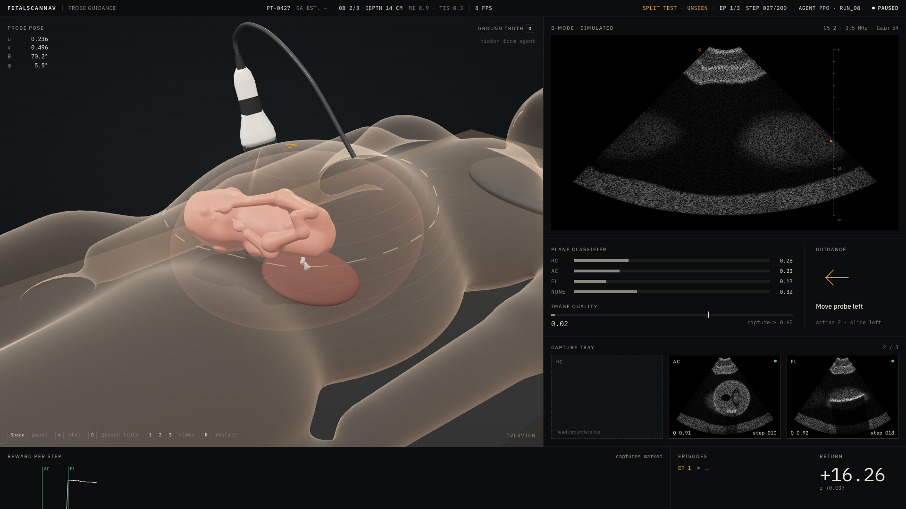

# FetalScanNav: reinforcement-learning probe guidance for fetal ultrasound

**Mission.** Rwandan health centres lack trained sonographers. My capstone builds a deep-learning ultrasound assistant that recognises fetal standard planes and estimates gestational age, so that midwives can perform reliable pregnancy scans. This project covers one part of that assistant: **probe guidance**. An RL agent learns to tell an inexperienced user how to move the probe (slide, rotate, tilt or freeze) to capture the three biometry planes: **head (HC)**, **abdomen (AC)** and **femur (FL)**. In the product these moves appear as guidance arrows on the midwife's phone.

All four algorithms (DQN, REINFORCE, PPO and A2C) are implemented with **TorchRL** and trained on the same custom Gymnasium environment, with the same 300k-frame budget per run.



---

## Quick start (uv only)

```bash
git clone <this repo> && cd eddy_irasetsa_rl_summative
uv sync
uv run main.py            # best agent, 3 episodes on the unseen split, 3D console + verbose terminal
```

| Command | What it does |
|---|---|
| `uv run main.py --algo ppo --split train --episodes 5 --fps 12` | choose algorithm, split, episodes and speed |
| `uv run main.py --no-browser` / `--no-gui` | do not open the browser / terminal only |
| `uv run python -m environment.rendering --demo` | 3D console replaying a recorded episode (no model needed) |
| `uv run python -m training.dqn_training --run all` (or `--run 9`) | DQN sweep (12 configs) |
| `uv run python -m training.pg_training --algo ppo --run all` | REINFORCE / PPO / A2C sweeps (12–13 configs each) |
| `uv run python -m training.run_sweeps` | all 50 runs in parallel, resumable |
| `uv run python -m training.seed_check` | best config of each method retrained with 3 fresh seeds |
| `uv run python -m analysis.make_plots` | regenerate every figure and `assets/plots/results_tables.md` |
| `uv run python -m analysis.baselines` | random, hill-climb and oracle reference policies |
| `uv run python -m api.server` | inference API: `GET /health`, `POST /act` |
| `uv run pytest -q` | environment and model tests |

Everything runs offline: three.js, its addons and the IBM Plex fonts are vendored in `assets/web/vendor/`.

---

## The environment: `FetalScanNav-v0`

A simplified pregnant patient lies supine. Inside her, a mid-trimester fetus has a **random presentation** (cephalic or breech in training), rotation and offset. The agent controls a virtual probe on the abdominal skin. It **never sees the fetus**: it only receives what a scanning app would have, namely probe pose readings and the outputs of image CNNs on the live frame. The task is therefore partially observable and sequential. Each move changes the next image, rewards are delayed until capture, and the agent must trade searching against capturing, and speed (the fetus moves) against image quality.

### Action space: `Discrete(9)`

| id | Action | Effect | Real-world mapping (guidance shown to the midwife) |
|---|---|---|---|
| 0 | Slide cranial | v += 0.025 | "Move probe up (towards head)" |
| 1 | Slide caudal | v −= 0.025 | "Move probe down (towards feet)" |
| 2 | Slide left | u −= 0.025 | "Move probe left" |
| 3 | Slide right | u += 0.025 | "Move probe right" |
| 4 | Rotate clockwise | θ += 10° | "Rotate probe clockwise" |
| 5 | Rotate anticlockwise | θ −= 10° | "Rotate probe anticlockwise" |
| 6 | Tilt (fan) forward | φ += 5° | "Fan probe towards head" |
| 7 | Tilt (fan) backward | φ −= 5° | "Fan probe towards feet" |
| 8 | Freeze and capture | save the frame as the most likely plane | "Hold still, freeze and save image" |

The moves carry actuation noise: 10% on slide magnitude, lateral jitter and 1.5° on rotation, standing in for hand tremor.

### Observation space: `Box(float32, (22,))`

| # | Observation | Meaning | Source / simulation rule | Encoding, range | Update |
|---|---|---|---|---|---|
| 0–1 | `u, v` | probe position on the abdomen | probe tracking (IMU + phone camera, or EM tracker) | float, [0, 1] | every step |
| 2–3 | `sin 2θ, cos 2θ` | probe rotation (plane orientation) | IMU gyroscope; 2θ because a plane is unchanged by a 180° turn | float, [−1, 1] | every step |
| 4 | `φ / φmax` | probe tilt | IMU accelerometer | float, [−1, 1] | every step |
| 5 | `q` | image quality | quality CNN; simulated as max alignment + speckle noise, larger near the abdomen edge | float, [0, 1] | every step |
| 6 | `Δq` | quality change | q(t) − q(t−1), computed in the app | float, [−1, 1] | every step |
| 7–10 | `p_HC, p_AC, p_FL, p_none` | plane classifier | capstone CNN; softmax over noisy visibility + alignment logits | float, [0, 1], sums to 1 | every step |
| 11–13 | `cap_HC, cap_AC, cap_FL` | planes already saved | app state | {0, 1} | on capture |
| 14 | `t_left` | scan time left | app timer, 1 − step/200 | float, [0, 1] | every step |
| 15 | `motion` | fetal movement detected | B-mode frame differencing | {0, 1} | every step |
| 16–17 | `est_du, est_dv` | estimated offset to the most likely uncaptured plane (×3) | plane-localisation CNN; noise σ = 0.02 + 0.15·distance | float, [−1, 1] | every step |
| 18–19 | `est_sin, est_cos` | estimated rotation error (2Δθ) | plane-localisation CNN; noise σ = 10° | float, [−1, 1] | every step |
| 20 | `est_dtilt` | estimated tilt error / φmax | plane-localisation CNN; noise σ = 4° | float, [−1, 1] | every step |
| 21 | `est_valid` | anatomy recognisable? | 1 if visibility ≥ 0.15, else 0 and fields 16–20 are zero | {0, 1} | every step |

The plane-localisation estimate (16–21) follows published slice-to-volume and probe-guidance work (Yeung et al., 2021; Droste et al., 2020). Without it, no algorithm completed a single scan in 300k frames during calibration. With the true relative pose given instead, DQN reached 52% success in 60k frames, which showed that the bottleneck was missing directional information, not the learning code. The estimate keeps the problem honest: it is noisy, only valid when the anatomy is in view, and it says nothing about when to capture or how to deal with fetal movement.

### Reward

```
r_t = −0.05                                  time cost per step
      + 2.0 · (0.99 · Φ(s_{t+1}) − Φ(s_t))    potential-based shaping, Φ = max over uncaptured planes of ½·visibility + ½·alignment
      + 10 · q      capture of a correct, uncaptured plane with q ≥ 0.65
      − 1           wrong, duplicate or low-quality capture
      − 5           probe leaves the scannable region (terminates)
      + 20 + 5 · t_left   all three planes captured (terminates)
```

The shaping is potential-based (Ng et al., 1999), so it speeds learning without changing the optimal policy. Alignment to plane *k* is `a_k = exp(−(d_pos/0.10)² − (d_rot/35°)² − (d_tilt/18°)²)`.

**Start state.** The probe starts within 0.1 of the abdomen centre with random rotation and tilt, nothing captured and the full time budget. The fetal pose is sampled from the training distribution.

**Terminal conditions.** The episode terminates on success (all 3 planes captured) or failure (probe leaves the region). It is truncated after 200 steps.

**Generalisation split.** `reset(options={"split": "test"})` samples conditions never seen in training: a **transverse** lie, larger fetal offsets (60–100% of the maximum instead of 0–60%) and three times more fetal movement.

---

## Results (all numbers from `logs/`, 100 evaluation episodes per split)

| Algorithm | Best run | Train return | Train success | Unseen-test return | Unseen success | Steps | Seeds that learned (best config) |
|---|---|---|---|---|---|---|---|
| **PPO** | run_08 | **47.01 ± 1.03** | **100%** | 46.65 | 99% | 39 | 3/3 |
| A2C | run_06 | 45.92 ± 1.16 | 100% | 45.78 | 100% | 39 | 3/3 |
| DQN | run_09 | 43.20 ± 5.62 | 98% | 37.60 | 97% | 47 | 3/3 |
| REINFORCE | run_10 | −10.80 ± 1.69 | 0% | −9.46 | 0% | 143 | 0/3 |
| *Oracle (reads hidden pose)* | – | 49.29 | 100% | 49.49 | 100% | 43 | – |
| *Random policy* | – | −33.61 | 0% | −33.20 | 0% | 199 | – |

* **DQN** learned in 12/12 configurations. ε-greedy keeps trying the capture action, so it always discovers the capture reward.
* **PPO and A2C are bimodal.** A configuration either solves the task (about 100%) or collapses to "never press capture" (return about −12): 7/13 PPO runs and 5/12 A2C runs learned. Larger effective steps (PPO lr 1e-3, 256-frame rollouts, entropy 0.05; A2C 8-step rollouts) escape the collapse. Small steps (PPO lr 1e-4, 3 epochs, 4096-frame rollouts) and zero entropy do not.
* **REINFORCE** (12/12 runs) never learned to capture within 300k frames. Monte-Carlo episode returns give only 100–400 high-variance updates per run.

Full per-run tables: [`assets/plots/results_tables.md`](assets/plots/results_tables.md). Figures: [`assets/plots/`](assets/plots/).

---

## Integration path

```
phone app ── probe IMU (u, v, θ, φ) ─────────────────────┐
          └─ live B-mode frame → capstone CNNs → q, p_plane, plane estimate
                                                         ▼
                              22-value observation → policy (TorchScript on device,
                                                     or POST /act on api/server.py)
                                                         ▼
                              action id → guidance arrow + text on screen
```

`api/server.py` serves the best policy (`POST /act` returns `{action_id, action_name, guidance_text, action_probs}`). Running `uv run python -m api.server --export-torchscript policy.pt` exports it for on-device inference. Policies are plain `nn.Sequential` MLPs saved as `models/<algo>/best/model.pt`.

## Repository layout

```
environment/   custom_env.py (FetalScanNav-v0) · rendering.py (HTTP + SSE bridge to the 3D console)
training/      common.py · dqn_training.py · pg_training.py · run_sweeps.py · seed_check.py · configs/
models/        dqn/run_xx, pg/{reinforce,ppo,a2c}/run_xx, each with best/ · seeds/
logs/          per-run CSVs: *_episodes, *_updates, *_eval · seeds/
analysis/      make_plots.py · baselines.py
assets/web/    three.js console (index.html, js/, styles.css, vendor/) · plots/ · screenshots/
api/           server.py (inference API)
tests/         test_env.py · test_models_load.py
```

## References

* Li, K. et al. (2021). *Autonomous Navigation of an Ultrasound Probe Towards Standard Scan Planes with Deep Reinforcement Learning.* arXiv:2103.00718.
* Dou, H. et al. *Agent with Tangent-based Formulation and Anatomical Perception for Standard Plane Localization in 3D Ultrasound* (AgentSPL). github.com/wulalago/AgentSPL.
* Yeung, P.-H. et al. (2021). *Learning to map 2D ultrasound images into 3D space with minimal human annotation.* Medical Image Analysis.
* Droste, R. et al. (2020). *Automatic Probe Movement Guidance for Freehand Obstetric Ultrasound.* MICCAI.
* Ng, A., Harada, D., Russell, S. (1999). *Policy invariance under reward transformations.* ICML.
